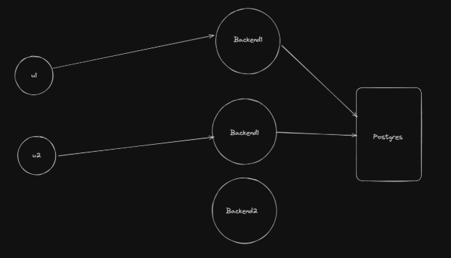
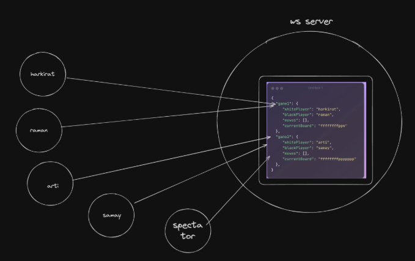
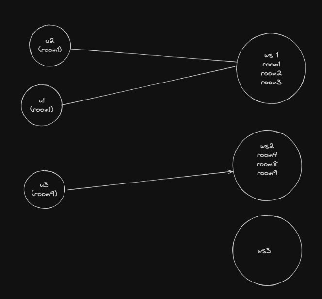
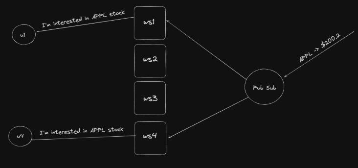

# Stateless Backend and Singleton Pattern

A learning project about one of the most important questions in backend engineering: **where does your server keep its data, and what happens when you run more than one server?**

Through small TypeScript demos, this repository walks from the simplest way of keeping data in memory, to the Singleton pattern that keeps that data organised, to Pub/Sub, which lets many servers work together.

---

## What's inside

| Folder | What it demonstrates |
|---|---|
| `Singleton Class` | A `GameManager` class that stores chess games in memory and is shared across the whole app using the Singleton pattern |
| `Singleton PubSubs` | A `PubSubManager` Singleton that connects to Redis so many servers can share live updates, such as stock prices |

---

## What we're learning

1. Stateful vs stateless backends
2. How to manage state inside a backend app
3. The Singleton pattern
4. Using Singleton with Pub/Sub to scale realtime updates across servers

---

## 1. Stateful vs stateless backends

**State** is any data a server remembers between requests: who is logged in, which players are in a game, what is sitting in a cache. Whether a server keeps state or not shapes how you can scale it, which is why this is a classic interview question.

### Stateless servers

Most HTTP servers are stateless. They keep no important data in their own memory. Every request carries what the server needs, and anything that must be remembered goes into a database.

<p align="center">
  
</p>

Think of a waiter who writes every order on a ticket and pins it in the kitchen. Any waiter can pick up any ticket, so it never matters who served you last time.

**Why this matters:**

- A user can be sent to **any** server, so no special routing is needed.
- You can **add or remove servers freely** (autoscaling) and route traffic based on load, such as CPU usage.
- If a server crashes, **nothing is lost**, because the data lives in the database.

### Stateful servers

Sometimes keeping data in memory is the right choice, because memory is far faster than a database. Common examples:

1. An **in-memory cache**, like in [code100x/cms](https://github.com/code100x/cms/blob/e905c71eacf9d99f68db802b24b7b3a924ae27f1/src/db/Cache.ts#L3)
2. The **state of a live game**, like in [code100x/chess](https://github.com/code100x/chess/blob/main/apps/ws/src/Game.ts#L41-L47)
3. The **latest few chat messages** in a chat app

<p align="center">
  
</p>

The trade-off is that the data now lives inside **one server's memory**. It disappears if that server restarts, and a second server does not have a copy.

### Stickiness

Some stateful cases need **stickiness**: making sure a user interested in a specific room or game always reaches the specific server that holds it. A cache does not need it, because any server can rebuild the same cache. A live chess game does, because only one server knows the current board.

<p align="center">
  
</p>

This leads to the next question: when you do need state in memory, how do you store it properly in a JavaScript project?

---

## 2. Storing state inside a JavaScript process

### Start simple: an exported variable

The easiest option is to create a list in one file and import it everywhere else. This works because Node.js loads each file only once and remembers it (called **module caching**), so every file that imports the list receives the very same one.

In our demo, one file adds games to the list every few seconds while another file prints it. Both see the same data.

### The limit of a plain variable

A bare list is just data. Nothing controls how it is changed, so any file can push anything into it. Real apps need **rules and behaviour attached to the data**: add a game, record a move, look up a game by id.

### Wrap it in a class

A **class** bundles the data and the operations on it into one unit. Our `GameManager` holds the games and exposes functions such as adding a game or a move. This is called **encapsulation**, and it keeps the rules for changing state in one place instead of scattered across the codebase.

(Libraries like Redux also manage state and can be used on the backend, but a plain class is the simplest way to see the idea.)

Classes bring a new problem, though: **who creates the object, and how do we make sure everyone uses the same one?**

| Approach | What it means | The problem |
|---|---|---|
| Bad | Every file creates its own `GameManager` | Each file gets a separate, empty list. The logger never sees the games that another file added |
| Better | Create one instance and export it | Works, but nothing stops another developer from creating a second one by mistake |
| Best | Singleton pattern | The class itself makes a second instance impossible |

---

## 3. The Singleton pattern

A **Singleton** is a class that can only ever have **one instance**, and the whole application shares it.

### How it works, in words

- The **constructor is private**, so nobody outside the class can create an object with `new`. If they try, TypeScript shows an error.
- The class keeps its single instance in a **static** property. Static means it belongs to the class itself, not to any object made from it.
- A method called `getInstance` hands out that instance. The first time it is called, it creates the object. Every call after that returns the same one.

Anywhere in the app, you ask the class for its instance and always get the same object.

### Why it matters

- **One source of truth.** Every part of the app sees the same data, so there are no mismatched copies.
- **Shared resources are created once.** Database connections, caches, loggers and configuration are expensive or messy to duplicate. A Singleton makes sure you open one connection, not fifty.
- **It protects you from mistakes.** The design makes it impossible to do the wrong thing by accident, instead of relying on everyone remembering a rule.

### Its limits

Singletons are useful but not magic. They behave like global state, which can make code harder to test. And a Singleton only exists **inside one running process**. If you run several servers, each has its own Singleton, and they know nothing about each other. That limit is what the next section solves.

---

## 4. Pub/Sub: making many servers work together

<p align="center">
  
</p>

### The problem

Picture a stock-price app running on several WebSocket servers. One user is connected to `ws1`, another to `ws4`, and both want updates on the `APPL` stock. When a new price arrives, it must reach **both** users. But `ws1` only knows its own users and `ws4` only knows its own. No single server can reach everyone.

### The solution

**Pub/Sub** (publish/subscribe) places a message broker between the servers. Here we use **Redis**. It works like a radio station with channels:

- A server **subscribes** to a channel, for example `APPL`.
- Whoever has news **publishes** it to that channel once.
- Redis delivers it to **every** subscribed server, and each server passes it on to its own connected users.

The publisher does not need to know who is listening, and servers can be added or removed without changing anything else. That is what makes it a good fit for scaling.

### Where the Singleton fits in

Each server runs a `PubSubManager` Singleton. It makes sure the server has:

- **One Redis connection**, not one per user.
- **One record of who is subscribed to what**, such as which users on this server want `APPL`.

It also keeps Redis traffic low. The **first** local user who wants `APPL` triggers a subscription to the Redis channel. Further users are simply added to the local list. When the **last** user leaves, the server unsubscribes. So a server holds exactly one subscription per stock, whether it has one user or a thousand.

This combines everything above: state in memory, shared safely through a Singleton, and connected across servers through Pub/Sub.

---

## What we built

- **Singleton Class:** a game store that a producer fills with chess games and a logger reads from. Both share one `GameManager`, which shows why the Singleton matters.
- **Singleton PubSubs:** a manager that simulates users subscribing to a stock, and talks to Redis only when it truly needs to.

---

## Running the demos

Each folder is its own project. `cd` into the one you want and run:

```bash
npm install
npx tsc -b
node dist/index.js
```

`Singleton PubSubs` also needs a **Redis server running locally** on the default port (6379). To watch a message arrive, publish one from another terminal with `redis-cli PUBLISH APPL 200.2`.

---

## Key takeaways

- **Stateless servers are easy to scale**, because any server can handle any request and nothing is lost when one goes down.
- **Stateful servers are fast but fragile**, because their data lives in one process's memory and may need stickiness.
- **Use a class to attach rules to your state**, and a **Singleton** to make sure the whole app shares one copy.
- **A Singleton is per process.** Once you run multiple servers, use **Pub/Sub** such as Redis so they can share updates.
